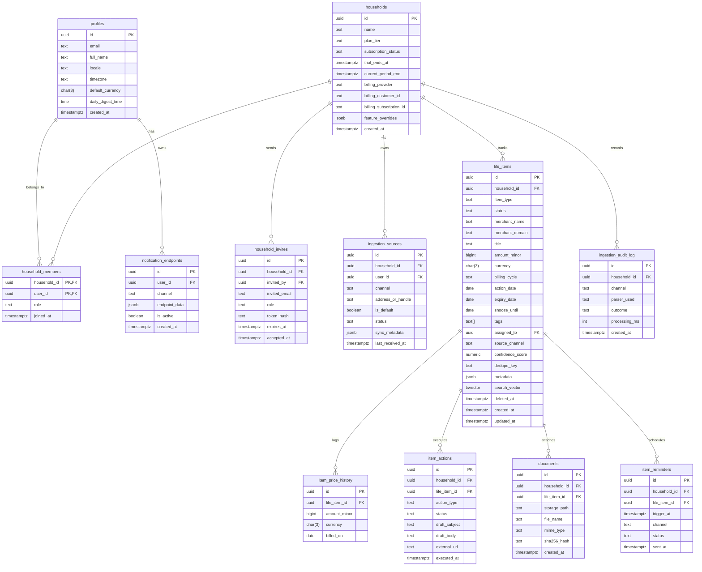
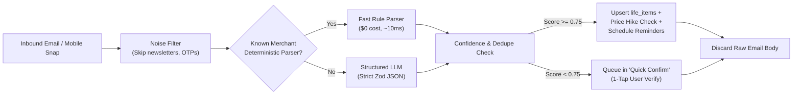

# Data Model & AI Extraction Design — Life Pulse

This document defines the **future-proofed database schema**, **Supabase security & RLS architecture**, **provider-agnostic subscription base**, and **hybrid AI extraction contract** for **Life Pulse** (US/UK/EU launch, India-ready from Day 1).

> [!IMPORTANT]
> **Future-Proofing Upgrades Applied Before Provisioning:**
> 1. **Zero Enum Lock-In for Extensible Fields:** `item_type` and `channel` use flexible `text` + `tags text[]` instead of rigid Postgres ENUMs, so adding future categories (`travel_booking`, `medical_appointment`, `car_maintenance`, `school_notice`, `tax_deadline`) or channels (`whatsapp_forward`, `gmail_oauth`) requires **zero DB migrations**.
> 2. **Built-In Future Tables:** Added `household_invites`, `item_actions` (1-tap AI cancel/return drafts & future autonomous actions), and `notification_endpoints` (multi-device Web Push / Email / WhatsApp).
> 3. **Billing-Safe Security:** Clients cannot self-upgrade `plan_tier` or `subscription_status`; `feature_overrides jsonb` lets you grant beta/VIP access without payment plumbing.
> 4. **Supabase Security Hardening:** Helper functions live in a non-exposed `private` schema with `SET search_path = ''`, all policies use `TO authenticated` + `(select auth.uid())`, and `UPDATE` policies enforce both `USING` and `WITH CHECK`.
> 5. **Instant Vault Search:** Generated `tsvector` full-text search index on `life_items` so plain-English queries (*"Sony TV warranty"*) work in milliseconds from Day 1.

---

## 1. Entity-Relationship Overview



---

## 2. Production Postgres Schema (Supabase-Ready)

All monetary amounts use **integer minor units** (`amount_minor`, e.g., `$19.99` = `1999`, `₹499.00` = `49900`) paired with an ISO 4217 `currency` code.

```sql
-- =============================================================================
-- 0. Private Schema for Internal Security Helpers (Not exposed via Data API)
-- =============================================================================
create schema if not exists private;
revoke all on schema private from public;
grant usage on schema private to authenticated;

-- Auto-update updated_at trigger helper
create or replace function private.set_updated_at()
returns trigger
language plpgsql
set search_path = ''
as $$
begin
  new.updated_at = now();
  return new;
end;
$$;

-- =============================================================================
-- 1. Profiles (extends Supabase auth.users)
-- =============================================================================
create table public.profiles (
  id uuid primary key references auth.users(id) on delete cascade,
  email text not null,
  full_name text,
  locale text not null default 'en-US',             -- en-US, en-GB, de-DE, en-IN
  timezone text not null default 'America/New_York',
  default_currency char(3) not null default 'USD',  -- USD, GBP, EUR, INR
  daily_digest_time time not null default '08:00:00',
  onboarding_completed_at timestamptz,
  created_at timestamptz not null default now(),
  updated_at timestamptz not null default now()
);

create trigger trg_profiles_updated_at
  before update on public.profiles
  for each row execute function private.set_updated_at();

-- =============================================================================
-- 2. Households, Members & Invites (Provider-Agnostic Subscription Base)
-- =============================================================================
create table public.households (
  id uuid primary key default gen_random_uuid(),
  name text not null default 'Personal',

  -- Subscription foundation (Stripe/Paddle/RevenueCat plugs into these later)
  plan_tier text not null default 'free'
    check (plan_tier in ('free', 'solo_pro', 'household')),
  subscription_status text not null default 'active'
    check (subscription_status in ('trialing', 'active', 'past_due', 'canceled')),
  trial_ends_at timestamptz,
  current_period_end timestamptz,
  billing_provider text not null default 'none'
    check (billing_provider in ('none', 'stripe', 'paddle', 'apple', 'google')),
  billing_customer_id text,
  billing_subscription_id text,
  feature_overrides jsonb not null default '{}'::jsonb, -- VIP/beta unlocks

  created_at timestamptz not null default now(),
  updated_at timestamptz not null default now()
);

create trigger trg_households_updated_at
  before update on public.households
  for each row execute function private.set_updated_at();

create table public.household_members (
  household_id uuid not null references public.households(id) on delete cascade,
  user_id uuid not null references public.profiles(id) on delete cascade,
  role text not null default 'owner' check (role in ('owner', 'member')),
  joined_at timestamptz not null default now(),
  primary key (household_id, user_id)
);

create index idx_household_members_user_id on public.household_members (user_id);

create table public.household_invites (
  id uuid primary key default gen_random_uuid(),
  household_id uuid not null references public.households(id) on delete cascade,
  invited_by uuid not null references public.profiles(id) on delete cascade,
  invited_email text not null,
  role text not null default 'member' check (role in ('owner', 'member')),
  token_hash text not null unique,
  expires_at timestamptz not null,
  accepted_at timestamptz,
  created_at timestamptz not null default now()
);

create index idx_household_invites_household_id on public.household_invites (household_id);

-- =============================================================================
-- 3. Ingestion Sources (Auto-Forward Default + Mobile Snap + Future OAuth/WA)
-- =============================================================================
create table public.ingestion_sources (
  id uuid primary key default gen_random_uuid(),
  household_id uuid not null references public.households(id) on delete cascade,
  user_id uuid not null references public.profiles(id) on delete cascade,
  channel text not null,              -- auto_forward | mobile_snap | gmail_oauth | outlook_oauth | whatsapp_forward
  address_or_handle text unique,      -- e.g., alex.k92@in.lifepulse.app
  is_default boolean not null default false,
  status text not null default 'pending_test'
    check (status in ('pending_test', 'active', 'paused', 'revoked')),
  sync_metadata jsonb not null default '{}'::jsonb, -- Future OAuth history_id / cursors (never raw tokens)
  last_received_at timestamptz,
  created_at timestamptz not null default now(),
  updated_at timestamptz not null default now()
);

create index idx_ingestion_sources_household_id on public.ingestion_sources (household_id);

create trigger trg_ingestion_sources_updated_at
  before update on public.ingestion_sources
  for each row execute function private.set_updated_at();

-- =============================================================================
-- 4. Unified Life Items (Extensible Item Types + Soft Delete + Instant Search)
-- =============================================================================
create table public.life_items (
  id uuid primary key default gen_random_uuid(),
  household_id uuid not null references public.households(id) on delete cascade,

  -- V1 types: subscription | order_return | bill_renewal | warranty_receipt
  -- Future types (no migration needed): travel_booking | appointment | car_maintenance | school_notice | tax_deadline
  item_type text not null,
  status text not null default 'active'
    check (status in ('needs_review', 'active', 'snoozed', 'resolved', 'archived')),

  merchant_name text not null,
  merchant_domain text,
  title text not null,

  amount_minor bigint check (amount_minor is null or amount_minor >= 0),
  currency char(3),
  billing_cycle text check (billing_cycle is null or billing_cycle in ('weekly', 'monthly', 'quarterly', 'yearly', 'one_time')),

  action_date date,                   -- Next charge, trial end, bill due, or event date
  expiry_date date,                   -- Return window deadline or warranty expiry
  snooze_until date,

  tags text[] not null default '{}',
  assigned_to uuid references public.profiles(id) on delete set null,
  source_channel text not null,
  confidence_score numeric(3,2) not null default 1.00
    check (confidence_score >= 0 and confidence_score <= 1),
  dedupe_key text not null,

  metadata jsonb not null default '{}'::jsonb,

  search_vector tsvector generated always as (
    setweight(to_tsvector('simple', coalesce(merchant_name, '')), 'A') ||
    setweight(to_tsvector('simple', coalesce(title, '')), 'A') ||
    setweight(to_tsvector('simple', coalesce(metadata->>'summary_one_liner', '')), 'B') ||
    setweight(to_tsvector('simple', coalesce(metadata->>'order_number', '')), 'B')
  ) stored,

  deleted_at timestamptz,
  created_at timestamptz not null default now(),
  updated_at timestamptz not null default now()
);

-- Partial unique index allows re-creating an item if a previous one was soft-deleted
create unique index idx_life_items_dedupe_active
  on public.life_items (household_id, dedupe_key)
  where deleted_at is null;

create index idx_life_items_daily_pulse
  on public.life_items (household_id, status, action_date, expiry_date)
  where deleted_at is null;

create index idx_life_items_search
  on public.life_items using gin (search_vector);

create index idx_life_items_tags
  on public.life_items using gin (tags);

create trigger trg_life_items_updated_at
  before update on public.life_items
  for each row execute function private.set_updated_at();

-- =============================================================================
-- 5. Price History (Automatic Price-Hike Detection)
-- =============================================================================
create table public.item_price_history (
  id uuid primary key default gen_random_uuid(),
  household_id uuid not null references public.households(id) on delete cascade,
  life_item_id uuid not null references public.life_items(id) on delete cascade,
  amount_minor bigint not null check (amount_minor >= 0),
  currency char(3) not null,
  billed_on date not null,
  created_at timestamptz not null default now()
);

create index idx_item_price_history_item_id
  on public.item_price_history (life_item_id, billed_on desc);

-- =============================================================================
-- 6. AI Action Drafts & Execution History (Cancel / Return / Dispute)
-- =============================================================================
create table public.item_actions (
  id uuid primary key default gen_random_uuid(),
  household_id uuid not null references public.households(id) on delete cascade,
  life_item_id uuid not null references public.life_items(id) on delete cascade,
  action_type text not null,          -- cancel_subscription | start_return | dispute_price_hike | warranty_claim
  status text not null default 'draft'
    check (status in ('draft', 'copied', 'sent', 'completed', 'dismissed')),
  draft_subject text,
  draft_body text,
  external_url text,
  executed_at timestamptz,
  created_at timestamptz not null default now(),
  updated_at timestamptz not null default now()
);

create index idx_item_actions_item_id on public.item_actions (life_item_id);

create trigger trg_item_actions_updated_at
  before update on public.item_actions
  for each row execute function private.set_updated_at();

-- =============================================================================
-- 7. Encrypted Vault Documents (Receipts, Warranties, PDFs, Photos)
-- =============================================================================
create table public.documents (
  id uuid primary key default gen_random_uuid(),
  household_id uuid not null references public.households(id) on delete cascade,
  life_item_id uuid references public.life_items(id) on delete set null,
  storage_path text not null,
  file_name text,
  mime_type text not null,
  file_size_bytes bigint,
  sha256_hash text not null,
  created_at timestamptz not null default now()
);

create index idx_documents_household_id on public.documents (household_id);
create index idx_documents_life_item_id on public.documents (life_item_id);
create unique index idx_documents_household_hash on public.documents (household_id, sha256_hash);

-- =============================================================================
-- 8. Scheduled Reminders & Multi-Device Notification Endpoints
-- =============================================================================
create table public.item_reminders (
  id uuid primary key default gen_random_uuid(),
  household_id uuid not null references public.households(id) on delete cascade,
  life_item_id uuid not null references public.life_items(id) on delete cascade,
  trigger_at timestamptz not null,
  channel text not null default 'web_push', -- web_push | email_digest | whatsapp
  status text not null default 'pending'
    check (status in ('pending', 'sent', 'cancelled', 'failed')),
  sent_at timestamptz,
  created_at timestamptz not null default now()
);

create index idx_item_reminders_due
  on public.item_reminders (trigger_at)
  where status = 'pending';

create table public.notification_endpoints (
  id uuid primary key default gen_random_uuid(),
  user_id uuid not null references public.profiles(id) on delete cascade,
  channel text not null,              -- web_push | email | whatsapp
  endpoint_data jsonb not null,       -- PushSubscription JSON, phone handle, etc.
  is_active boolean not null default true,
  created_at timestamptz not null default now(),
  updated_at timestamptz not null default now()
);

create index idx_notification_endpoints_user_id on public.notification_endpoints (user_id);

create trigger trg_notification_endpoints_updated_at
  before update on public.notification_endpoints
  for each row execute function private.set_updated_at();

-- =============================================================================
-- 9. Privacy-First Ingestion Audit Log (Zero Raw Email Storage)
-- =============================================================================
create table public.ingestion_audit_log (
  id uuid primary key default gen_random_uuid(),
  household_id uuid not null references public.households(id) on delete cascade,
  channel text not null,
  parser_used text not null,          -- e.g. 'deterministic:amazon' | 'llm:gemini-flash'
  outcome text not null check (outcome in ('parsed', 'needs_review', 'ignored_noise', 'failed')),
  processing_ms int,
  created_at timestamptz not null default now()
);

create index idx_ingestion_audit_log_household_id
  on public.ingestion_audit_log (household_id, created_at desc);
```

---

## 3. Hardened Supabase RLS & Auto-Provisioning Trigger

1. **Private Membership Helper** (not exposed on the public Data API):

```sql
create or replace function private.is_household_member(target_household_id uuid)
returns boolean
language sql
security definer
set search_path = ''
stable
as $$
  select exists (
    select 1
    from public.household_members
    where household_id = target_household_id
      and user_id = (select auth.uid())
  );
$$;

revoke all on function private.is_household_member(uuid) from public;
grant execute on function private.is_household_member(uuid) to authenticated;
```

2. **Billing Protection on `households`:** Members can read their household, and owners can rename it—**only the server (`service_role`) can update `plan_tier`, `subscription_status`, or `billing_*` columns** (enforced via column-level `GRANT` or trigger).
3. **Auto-Provisioning Trigger on Signup (`auth.users`):** Every new signup atomically receives:
   - A `profiles` row
   - A 1-person `households` row (`plan_tier = 'free'`)
   - A `household_members` (`owner`) link
   - A unique default `auto_forward` alias in `ingestion_sources` (e.g., `u-<short-id>@in.lifepulse.app`)

---

## 4. Hybrid Extraction Pipeline



---

## 5. Strict AI Extraction Schema (TypeScript + Zod)

```typescript
import { z } from 'zod';

export const ExtractedLifeItemSchema = z.object({
  is_relevant_life_admin: z
    .boolean()
    .describe('False for marketing newsletters, OTPs, shipping ads, or social notifications.'),

  item_type: z
    .enum(['subscription', 'order_return', 'bill_renewal', 'warranty_receipt'])
    .nullable(),

  merchant_name: z.string().min(1).max(120),
  merchant_domain: z.string().nullable().describe('Root domain e.g. amazon.co.uk, netflix.com'),
  title: z.string().min(1).max(140).describe('Short human label for Today Pulse card'),

  amount_minor: z
    .number()
    .int()
    .nonnegative()
    .nullable()
    .describe('Total amount in smallest currency unit (e.g. 1999 for $19.99, 49900 for ₹499.00)'),
  currency: z.enum(['USD', 'GBP', 'EUR', 'INR', 'CAD', 'AUD']).nullable(),

  billing_cycle: z.enum(['weekly', 'monthly', 'quarterly', 'yearly', 'one_time']).nullable(),

  action_date: z
    .string()
    .regex(/^\d{4}-\d{2}-\d{2}$/)
    .nullable()
    .describe('Next charge date, free-trial conversion date, or bill due date'),

  expiry_date: z
    .string()
    .regex(/^\d{4}-\d{2}-\d{2}$/)
    .nullable()
    .describe('Return window closing date or warranty expiration date'),

  tags: z.array(z.string().max(32)).max(5).default([]),

  metadata: z.object({
    is_free_trial: z.boolean().default(false),
    auto_renews: z.boolean().default(false),
    order_number: z.string().nullable().default(null),
    policy_or_account_ref: z.string().nullable().default(null),
    cancel_or_manage_url: z.string().url().nullable().default(null),
    return_portal_url: z.string().url().nullable().default(null),
    warranty_months: z.number().int().positive().nullable().default(null),
    summary_one_liner: z.string().max(180),
  }),

  confidence_score: z
    .number()
    .min(0)
    .max(1)
    .describe('Model confidence in extracted dates and amounts. < 0.75 triggers Quick Confirm.'),

  dedupe_key: z.string().min(3).max(160),
});

export type ExtractedLifeItem = z.infer<typeof ExtractedLifeItemSchema>;
```

### Regional Fallback Logic (Applied Post-Extraction)
* **UK / EU:** `delivery_date + 14 days` (statutory online distance-selling minimum)
* **US:** Merchant table lookup (e.g., Amazon/Target = `30 days`), fallback `30 days`
* **India:** Merchant table lookup (e.g., Amazon.in/Flipkart = `7 days`), fallback `7 days`

---

## 6. Subscription Entitlements Base (No Payment Provider Required Yet)

All feature gating goes through a single server-side `getHouseholdEntitlements(household)` helper backed by `households.plan_tier` + `subscription_status` + `feature_overrides`.

| Capability | `free` | `solo_pro` | `household` |
| :--- | :--- | :--- | :--- |
| Active tracked items | Up to 5 | Unlimited | Unlimited |
| Ingestion channels | Auto-Forward + Mobile Snap | Auto-Forward + Mobile Snap (+ OAuth opt-in) | Auto-Forward + Mobile Snap (+ OAuth opt-in) |
| Daily Morning Pulse | Yes | Yes | Yes (Shared) |
| Price-hike & return-window alerts | Basic | Full | Full |
| Receipt & Warranty Vault | 10 docs | Unlimited | Unlimited (Shared) |
| 1-Tap AI cancel/return drafts | — | Yes | Yes |
| Household members | 1 | 1 | Up to 2–4 |

---

## 7. GDPR Compliance Architecture (EU/UK First)

Hosted in **`eu-west-1` (Ireland)** with compliance built directly into the schema:
1. **Consent Ledger (`user_consents` — Article 7):** Tracks explicit, versioned consent for `terms_of_service`, `privacy_policy`, `email_parsing`, `ai_extraction`, and optional `marketing_emails`, with `granted_at`, `revoked_at`, and hashed IP (`ip_hash`, never raw IP).
2. **DSAR & Right to Erasure (`privacy_requests` — Articles 15, 17, 20):** Tracks self-serve JSON/ZIP data exports (`export`), full account erasures (`delete_account`), and vault purges (`purge_documents`). All PII tables use `ON DELETE CASCADE`.
3. **Data Minimization & Retention (`households.data_retention_months` — Article 5):** Raw email bodies are discarded immediately in-memory (`ingestion_audit_log.raw_body_discarded = true`), and households control how long resolved/archived items are retained (default 24 months).
4. **Encrypted Private Storage (`vault-documents`):** Private Supabase Storage bucket (`public = false`) restricted by household RLS policies (`SELECT`, `INSERT`, `UPDATE`, `DELETE`) scoped to `<household_id>/<file>`.

